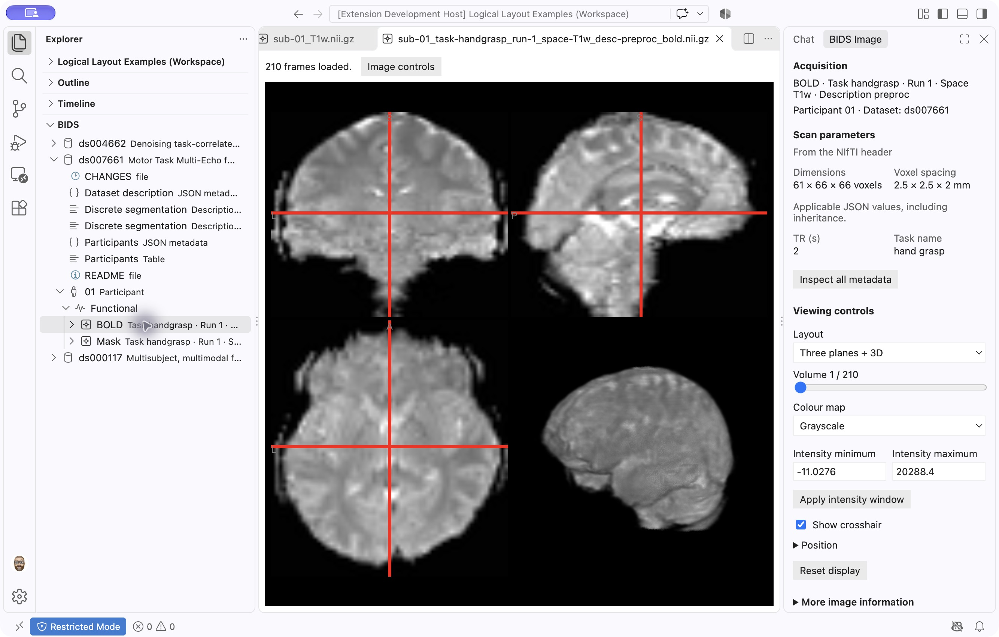

# BIDS Explorer

**Explore a BIDS study by participant, session and scan—on your computer or over SSH.**

View MRI images, read acquisition metadata and find participants with the sessions or processing outputs you need. BIDS Explorer brings folders and supported archives into one logical study tree, while keeping original filenames and sources accessible. Browsing leaves your dataset unchanged.

_Functional MRI example from the public [OpenNeuro ds007661 dataset](https://openneuro.org/datasets/ds007661). The BIDS tree is on the left; image information and controls are on the right._

## What you can do

- **Navigate a study:** browse participants, sessions, anatomical and functional scans, diffusion data and processing outputs. Multi-echo acquisitions keep their echoes together.
- **View images:** open NIfTI images in the built-in viewer, inspect three orthogonal planes and a 3D view, and move through 4D volumes. No separate viewer extension is required.
- **Understand metadata:** inspect TR, TE and other recorded parameters, see inherited JSON values and trace them to their original files. Preview participant tables, event timing and diffusion gradients.
- **Find usable coverage:** filter participant availability by raw sessions and processing outputs, including explicitly linked derivative datasets.
- **Browse data where it lives:** use local folders or VS Code Remote SSH, including ZIP, supported tarballs and SquashFS collections. Selected archive images are prepared in a cache without unpacking the entire study.

## Install and try it

**[Five-minute Quickstart](docs/QUICKSTART.md)** · Open a T1-weighted MRI from a 13 MB public sample, explore the Imaging controls and find the original file. No terminal commands needed. For a study on a server, follow the [Remote SSH walkthrough](docs/REMOTE_SSH.md).

1. Install [desktop VS Code](https://code.visualstudio.com/) 1.96 or newer.
2. Install [BIDS Explorer from the Visual Studio Marketplace](https://marketplace.visualstudio.com/items?itemName=MCIN-dlq.bids-explorer), published by **Darcy Quesnel (`MCIN-dlq`)**. For manual installation, use the [VSIX from the latest GitHub release](https://github.com/dlq/bids-explorer/releases/latest) with **Extensions → … → Install from VSIX…**.
3. Open a study folder you trust. In the **Explorer** sidebar, expand **BIDS**. A folder containing `dataset_description.json` appears automatically; otherwise choose **Add Dataset**.
4. Expand a participant, a session if present, and a modality, then select a scan. Choose **Image controls** to show its parameters and viewing controls.

For step-by-step server setup, follow the [Remote SSH walkthrough](docs/REMOTE_SSH.md). First connect using [VS Code Remote SSH](https://code.visualstudio.com/docs/remote/ssh), open the server’s study folder, and install BIDS Explorer on the connected host. To place image controls on the right, right-click **Imaging** and choose **Move To → Secondary Side Bar**.

Older development copies used publisher `bids-explorer-dev`. Disable that copy before installing the production extension to avoid duplicate commands; manual dataset registrations may need to be recreated. Dataset files are unchanged.

## What to expect

The BIDS tree is a readable study view; the regular File Explorer still shows the physical files. Original participant/session identifiers and filenames remain available in source details. In availability summaries, **Missing** means no matching data was found within the checked scope; **Not checked** means coverage is incomplete.

Archive support has compression and size limits. Large collections may need an initial background index; supported indexes are cached for later connections. The viewer can show the first volume of a 4D image while the rest loads. See [supported formats and tested platforms](docs/COMPATIBILITY.md).

The current release explores data without validating, renaming or restructuring it. Image overlays, such as displaying a segmentation over an anatomical reference, are planned for later. Opening an original file in a regular editor is a separate action that can allow edits.

For a complete first-use walkthrough, see the [Marketplace getting-started guide](docs/MARKETPLACE.md), which is bundled with the extension.

## Help and feedback

- [Remote SSH walkthrough](docs/REMOTE_SSH.md): connect, sign in and browse a study on a server.
- [Troubleshooting](docs/TROUBLESHOOTING.md): missing studies, SSH/MFA, archives, image loading and caches.
- [User guide](docs/USER_GUIDE.md): metadata, tables, derivatives, keyboard navigation and viewing controls.
- [Explorer reference](docs/EXPLORER_REFERENCE.md): detailed behavior, source collections and troubleshooting.
- [Report a problem or suggest an improvement](https://github.com/dlq/bids-explorer/issues/new/choose): omit private participant information, dataset paths and sensitive screenshots.
- [Contributing](CONTRIBUTING.md) · [Development setup](docs/DEVELOPMENT.md) · [Release notes](CHANGELOG.md) · [Roadmap](PLANS.md) · [Security reporting](SECURITY.md).

BIDS Explorer is available under the [MIT license](LICENSE). BIDS Explorer is distributed through the Marketplace and GitHub releases. Image rendering uses [NiiVue](https://github.com/niivue/niivue); bundled dependency notices are in [THIRD_PARTY_NOTICES.txt](THIRD_PARTY_NOTICES.txt).

## Contribute without writing code

- Try the Quickstart and tell us which step was hard to follow. Mention your OS and VS Code version so we can reproduce it.
- Suggest clearer wording for a scan label, metadata field or guide. Tell us what you expected to see in your neuroimaging workflow.
- Share a link to a small public BIDS study that shows a browsing or display problem, and describe what you expected BIDS Explorer to show.

Use GitHub Issues to share feedback. Use public or synthetic data and omit private paths and participant details. [Give feedback](https://github.com/dlq/bids-explorer/issues/new/choose) · [Contribution guide](CONTRIBUTING.md)

## Citation

If BIDS Explorer supports your research, use [CITATION.cff](CITATION.cff) or GitHub’s **Cite this repository** control to cite the version you used. Cite datasets and relevant methods separately. A software DOI has not been assigned.
