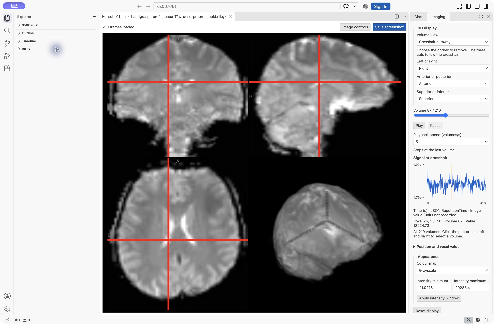

# Everyday workflows in BIDS Explorer

| What you want to find out                                               | Where to look                                                           |
| ----------------------------------------------------------------------- | ----------------------------------------------------------------------- |
| What age, group or study site did the dataset record for a participant? | Open **Participants** (`participants.tsv`).                             |
| Which participants have both raw sessions and an fMRIPrep output?       | Open **Show Participant Availability** from the dataset's context menu. |

Start with an open study in the **BIDS** section of VS Code's Explorer. For your first study or a server connection, see the [five-minute Quickstart](QUICKSTART.md) or [Remote SSH walkthrough](REMOTE_SSH.md).

## Look up a participant's recorded attributes

1. Open **Participants** in the dataset's metadata entries. Enter an identifier such as `sub-001` in **Filter rows**. The filter looks for text in any cell, so check the `participant_id` column for the exact identifier.
2. If **Apply filter** appears, select it to scan the large table. Use **Previous page** and **Next page** to browse matches. The preview reports how many rows it checked. If you choose **Cancel scan**, the last completed page stays visible and the cancelled search has incomplete coverage.
3. Read the recorded value and expand **Column dictionary** for definitions, units or category codes if the dataset supplies them. For example, a synthetic table might record `group` as `control` for `sub-001`. A row records attributes supplied by the study. Use Availability to check the files present for that participant.

## Find participants with the sessions and outputs you need

1. Right-click the raw dataset and choose **Show Participant Availability**.
2. Under **Require raw data in every selected session**, select the sessions you need. For example, select `01` and `02` in a synthetic two-visit study.
3. Under **Require derivative output**, select the pipeline, such as fMRIPrep, and choose a session or modality if needed. Check **Require output**, then choose **Apply filters**.

The results count shows confirmed matches among indexed participants. **Missing** means the inspected branch had no matching data. **Not checked** means coverage is incomplete. If the view reports partial coverage, more participants may match. Check the reported source issues and refresh to retry. A matching derivative output indicates that a file is present within the checked scope.

## Check where an acquisition parameter came from

Right-click a scan and choose **Inspect Metadata and Related Files**. Look for the effective value and its source. For example, a study-level `task-rest_bold.json` can supply `RepetitionTime` for a resting-state scan whose own sidecar omits that field. A more specific applicable sidecar can override it. If the inspector reports ambiguous sources or incomplete coverage, open the listed source files to see what each one records. [Metadata inheritance reference](EXPLORER_REFERENCE.md#inherited-metadata-and-related-files)

## Browse a study stored in archives

Open the folder containing the ZIP, tar or SquashFS files and use **Add Dataset** if needed. Expand the study, participant and session in **BIDS**. If several physical sources supply an entry, choose the source you want and use **Show Source Details** to check its archive and member path. A large collection may need an initial index before its coverage is complete. [Supported formats and limits](COMPATIBILITY.md)

## Include derivatives stored in another folder

Register the raw and derivative folders and add the derivative folder to the raw dataset's entry in the workspace setting `bidsExplorer.derivativeDatasets`. Use file URIs on the machine hosting the data. Reopen Availability from the raw dataset and check that the pipeline appears in **Require derivative output**. For an individual participant, look in the session's **Derivatives** branch. Session labels must match exactly. [Workspace settings example](EXPLORER_REFERENCE.md#link-separate-raw-and-derivative-datasets)

## Inspect images and diffusion gradients

Select a NIfTI image, then choose **Image controls** to open **Imaging**.

_Public [OpenNeuro ds007661](https://openneuro.org/datasets/ds007661) example. The orange marker in the signal plot and the Volume slider both indicate volume 87 of 210._

- **Review a 4D run.** Once all volumes have loaded, choose **Play**. Adjust **Playback speed (volumes/s)** or choose **Pause** to stop on a volume. Moving the **Volume** slider pauses playback at your selection. Display speed is independent of acquisition timing.
- **Inspect the signal at one voxel.** Move the crosshair to choose a voxel and read **Signal at crosshair**. The trace shows its values across volumes; playback and the Volume slider move the marker. Click the plot or use Left and Right to select a volume. The axis uses seconds when timing is established and volume numbers otherwise. Long runs show at most 4,096 evenly spaced samples, with a visible coverage note.
- **Read a voxel value.** Expand **Position and voxel value**. Move the crosshair with the axis buttons or enter X, Y and Z and choose **Go to position**. The value follows the crosshair and the current volume of a 4D scan. For coordinates in image space, choose **Physical image coordinates**.
- **Compare slices.** Choose **Lightbox** in **Layout**, select a plane, set the first slice, last slice and spacing, then choose **Apply slice range**. Use **Slice orientation** to choose **Neurological (left on left)** or **Radiological (left on right)**.
- **See inside the 3D volume.** In a layout with a 3D panel, use the default **Crosshair cutaway** under **3D display**. Pick the anatomical corner you want to remove and move the crosshair to move the cuts.
- **Save the displayed view.** Choose **Save screenshot** above the image, then choose a destination for the PNG. The caption includes the source filename, which may contain a participant label. Review it before sharing.

For a diffusion scan, select its `.bval` or `.bvec` file to inspect the matching pair. If the pair comes from elsewhere in the study, use **Inspect Metadata and Related Files** on the DWI image and choose **Preview resolved diffusion gradients** when both sources resolve. [Imaging controls and export details](EXPLORER_REFERENCE.md#native-imaging-view)
