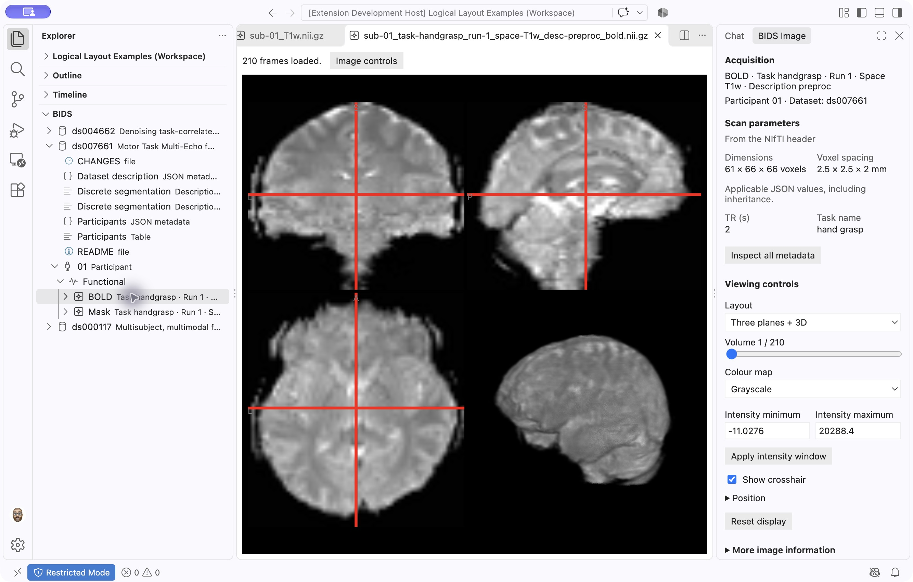

# BIDS Explorer

**Explore your neuroimaging study by participant, session and scan—locally or over SSH.**

BIDS Explorer is a read-only study browser for datasets organized using the Brain Imaging Data Structure (BIDS). View MRI images, understand acquisition metadata and find participants with the sessions or processing outputs you need. Browse ordinary folders, ZIP files, supported tarballs and SquashFS collections in one logical study tree.

_Public functional MRI example from [OpenNeuro ds007661](https://openneuro.org/datasets/ds007661). Study navigation is on the left; image information and controls are on the right._

## Install and try it

**[Five-minute Quickstart](https://github.com/dlq/bids-explorer/blob/main/docs/QUICKSTART.md)** · Open a T1-weighted MRI from a 13 MB public sample, explore the Imaging controls and find the original file. No terminal commands needed. For a study on a server, follow the [Remote SSH walkthrough](https://github.com/dlq/bids-explorer/blob/main/docs/REMOTE_SSH.md).

Select **Install** on this Marketplace page or in VS Code’s Extensions view. The publisher is **Darcy Quesnel**, with publisher ID **MCIN-dlq**. The full extension identifier is `MCIN-dlq.bids-explorer`.

You need desktop [Visual Studio Code](https://code.visualstudio.com/) **1.96 or newer** and access to a study folder you trust. For data on a server, also install Microsoft’s **Remote - SSH** extension. A separate NiiVue extension, Python, archive utilities and administrator access are not required for the supported browsing and imaging workflows.

If you previously installed a development VSIX published as `bids-explorer-dev`, disable or uninstall that copy before using this one. VS Code treats these as different extensions; manual dataset registrations may need to be added again. Your dataset files are unaffected.

## Open your first study

1. In VS Code, choose **File → Open Folder…** and select the study’s top-level folder—the one that normally contains `dataset_description.json` and the participant folders.
2. Open **Explorer** on the left and expand the **BIDS** section. A workspace folder with a root-level `dataset_description.json` appears automatically.
3. If your study does not appear, choose **Add Dataset** in the BIDS section, or open the Command Palette and run **BIDS Explorer: Add Dataset**. Select the study folder.
4. Expand a participant, then a session if the study has sessions, then a modality such as **Anatomical**, **Functional** or **Diffusion**.
5. Select an acquisition to open its image. Expand the acquisition to reach its image, acquisition metadata and matching original JSON, events or diffusion-gradient files.

The BIDS tree presents a logical study layout. Participant and session labels omit the repeated `sub-` and `ses-` prefixes; scans have readable names such as **T1-weighted**, **BOLD** and **Diffusion**, with task, run, echo and other distinctions beside them. Full filenames and source locations remain available in tooltips and source details. The regular **File Explorer** still shows the complete physical folder layout.

Sessionless studies work too. Multi-echo acquisitions group their echoes together. Metadata entries appear before subtrees to make each level easier to scan.

## Work with a study over SSH

New to remote connections? Follow the [beginner Remote SSH walkthrough](https://github.com/dlq/bids-explorer/blob/main/docs/REMOTE_SSH.md), from installing Remote - SSH through opening your first scan.

1. Connect to the server using **Remote - SSH**. Complete any password or MFA prompt shown by VS Code; prompts may appear at the top of the window.
2. Open the study folder on that server.
3. In Extensions, install BIDS Explorer on the connected SSH host. Installing only on your own computer may leave it unavailable in the remote window.
4. Open **Explorer → BIDS** and browse as you would locally.

Archive reading and indexing run beside the data on the server, using the VS Code connection. Selected images still need to reach your computer to be displayed. No separate SSH configuration is needed inside BIDS Explorer. See Microsoft’s [Remote SSH guide](https://code.visualstudio.com/docs/remote/ssh) for connection setup.

## View MRI images and acquisition parameters

Click a NIfTI image or its acquisition label to use the built-in viewer. The default layout shows **axial, coronal and sagittal planes plus a 3D volume view**. For a 4D scan, the first volume can appear while the remaining volumes load.

Choose **Image controls** to open the native **Imaging** sidebar. To place it on the right, right-click **Imaging** and choose **Move To → Secondary Side Bar**. VS Code remembers its position.

The sidebar includes:

- **Acquisition context:** participant, dataset, task, run and other recorded scan distinctions.
- **Scan parameters:** image dimensions and voxel spacing, plus applicable JSON values such as TR in seconds and TE in milliseconds when recorded.
- **Viewing controls:** layout, colour map, intensity range, crosshair and volume selection for loaded 4D data. Expand **Position** to move the crosshair one voxel at a time.
- **Source details:** the original files and exact values behind the displayed information.

Use **Reset display** to restore the default presentation. **Open Image With…** lets you choose another installed VS Code editor if you prefer. Reopening an already-open image returns to its existing viewer.

## Understand metadata, events and diffusion gradients

| What you want to inspect               | What to open                                                                                        |
| -------------------------------------- | --------------------------------------------------------------------------------------------------- |
| Study title, authors and BIDS version  | **Dataset description**                                                                             |
| Participant characteristics            | **Participants** table; expand **Column dictionary** for recorded definitions                       |
| Sessions or recorded scans             | The relevant sessions or scans table                                                                |
| Task timing                            | An **Events** table; onset and duration are shown in seconds                                        |
| Acquisition parameters and inheritance | **Acquisition metadata**, or right-click an image and choose **Inspect Metadata and Related Files** |
| Diffusion directions and b-values      | A `.bvec` or `.bval` resource to open its paired gradient preview                                   |
| Study release history                  | `CHANGES`                                                                                           |

Opening a JSON file directly shows what that file records. The acquisition metadata view can also resolve applicable values inherited from broader dataset, participant or session scopes, with their sources. Conflicting or incomplete sources are explained rather than silently combined.

A table inside an archive uses a JSON column dictionary next to it in the same archive. Use **Inspect Metadata and Related Files** to examine inherited metadata from other locations or sources.

Use **Filter rows** in table previews and **Reload snapshot** when the source has changed. **Open original** opens the underlying resource in an editor; saving from a regular editor is a separate action that can change an ordinary source file.

## Find participants with the data you need

Right-click the dataset and choose **Show Participant Availability**. Select the raw sessions and processing outputs you need, then choose **Apply filters**. Search and page through the matching participants instead of displaying tens of thousands of rows at once.

**Missing** means no matching data was found within the checked scope. **Not checked** means coverage is incomplete; it is not evidence that the data is absent. Large collections can build an availability index in the background, with progress and cancellation. Supported cached indexes can be reused after reconnecting when their sources are unchanged.

Processing outputs appear under matching session-level **Derivatives** branches. Outputs without a session appear under **Derivatives without a session**. Raw and derivative datasets stored separately need explicit links; matching participant labels alone do not establish that relationship. See [linking separate datasets](https://github.com/dlq/bids-explorer/blob/main/docs/EXPLORER_REFERENCE.md#link-separate-raw-and-derivative-datasets).

## Browse archives without unpacking the study

Add or open the folder containing your archives. Supported sources can contribute to the logical participant/session tree while retaining their original archive and member identities. If files conflict, source choices remain available. For one SquashFS image, use **BIDS Explorer: Browse SquashFS Image**.

| Source           | Supported scope                                                                               |
| ---------------- | --------------------------------------------------------------------------------------------- |
| Ordinary folders | Local or Remote SSH files                                                                     |
| ZIP              | Unencrypted stored or Deflate members                                                         |
| Tarballs         | POSIX ustar in `.tar`, `.tar.gz` and `.tgz`                                                   |
| SquashFS         | SquashFS 4.0 with uncompressed or gzip blocks; collections retain paging and partial coverage |

Large collections may need an initial index. Selected archived images are prepared in a private cache before viewing; a tarball may require a sequential scan. Unsupported compression is reported explicitly. NIfTI viewing currently has a 1 GiB decoded-data limit, and selected archive image extraction has a 512 MiB limit. Metadata and table previews are bounded snapshots rather than unlimited table readers. See [format, size and platform details](https://github.com/dlq/bids-explorer/blob/main/docs/COMPATIBILITY.md).

For fuller recovery instructions, see [Troubleshooting](https://github.com/dlq/bids-explorer/blob/main/docs/TROUBLESHOOTING.md).

## If something does not appear or open

| What you see                                    | What to try                                                                                                                         |
| ----------------------------------------------- | ----------------------------------------------------------------------------------------------------------------------------------- |
| No dataset in BIDS                              | Expand the section and choose **Add Dataset**. Automatic recognition expects a root-level `dataset_description.json`.               |
| BIDS Explorer is unavailable over SSH           | Install it on the connected SSH host and complete any pending VS Code authentication prompt.                                        |
| An unfamiliar file is absent from BIDS          | Look in the regular File Explorer. The logical tree omits administrative and unrecognized entries; this is not a validation result. |
| Old tree contents or metadata                   | Refresh the dataset or branch; use **Reload snapshot** in previews.                                                                 |
| An archived image takes time to open            | Allow the selected image to be prepared. Tar reads are sequential; the full archive is not unpacked into your dataset.              |
| No image data                                   | Some public BIDS examples contain empty image placeholders; these cannot be rendered.                                               |
| An unsupported shard or incomplete availability | Check the reported coverage and supported compression. Unreadable or unindexed sources are not treated as missing data.             |
| The extracted-image cache is full               | Close its viewers and editor tabs in every window using that workspace, then run **BIDS Explorer: Clear Extracted Image Cache**.    |

## Keyboard access

Use arrow keys to navigate and expand the BIDS tree, **Enter** to open, and **Shift+F10** for the selected entry’s actions. Use **Tab** to reach filters, table scrolling regions and disclosure controls. The volume selector accepts arrow keys, and the Imaging sidebar’s **Position** buttons provide keyboard crosshair movement.

Open the Command Palette with **Cmd+Shift+P** on macOS or **Ctrl+Shift+P** on Windows/Linux. Extension commands start with **BIDS Explorer:**. Previews follow the VS Code theme; sampled keyboard, high-contrast and VoiceOver checks are documented in the [usability record](https://github.com/dlq/bids-explorer/blob/main/docs/USABILITY.md).

## Read-only exploration and current boundaries

Browsing, filtering and previews leave source datasets unchanged. Selected archived images, inventories and indexes use extension storage outside the dataset. BIDS Explorer does not send dataset content to an analytics service. Check original-file editor behavior separately if you open a resource for editing.

This extension does not currently validate or fix BIDS conformance, rename or reorganize files, run processing pipelines, or display derivative images as overlays on a reference image. Those are separate future workflows. The most extensive interactive testing has been on macOS and Linux Remote SSH; hosted Linux tests use synthetic studies. See the [compatibility record](https://github.com/dlq/bids-explorer/blob/main/docs/COMPATIBILITY.md) for tested versions and limits.

## Help, feedback and credits

- [User guide](https://github.com/dlq/bids-explorer/blob/main/docs/USER_GUIDE.md) and [Explorer reference](https://github.com/dlq/bids-explorer/blob/main/docs/EXPLORER_REFERENCE.md).
- [Report a problem or request a feature](https://github.com/dlq/bids-explorer/issues/new/choose). Include extension/VS Code versions, storage format and a small public or synthetic reproduction. Remove private participant information, paths and sensitive screenshots.
- [Private security reporting](https://github.com/dlq/bids-explorer/security/advisories/new), [release notes](https://github.com/dlq/bids-explorer/blob/main/CHANGELOG.md) and [planned work](https://github.com/dlq/bids-explorer/blob/main/PLANS.md).

You can contribute without writing code. Tell us where the Quickstart was hard to follow, suggest clearer neuroimaging labels or share a public BIDS example that reveals a gap. [Ways to contribute on GitHub](https://github.com/dlq/bids-explorer#contribute-without-writing-code)

BIDS Explorer is [MIT-licensed](https://github.com/dlq/bids-explorer/blob/main/LICENSE). Image rendering uses the bundled [NiiVue](https://github.com/niivue/niivue) library. Dependencies and datasets retain their own licenses; see [third-party notices](https://github.com/dlq/bids-explorer/blob/main/THIRD_PARTY_NOTICES.txt).

To acknowledge the software in research, use [citation information](https://github.com/dlq/bids-explorer/blob/main/CITATION.cff) for the version you used, and cite datasets and methods separately.
