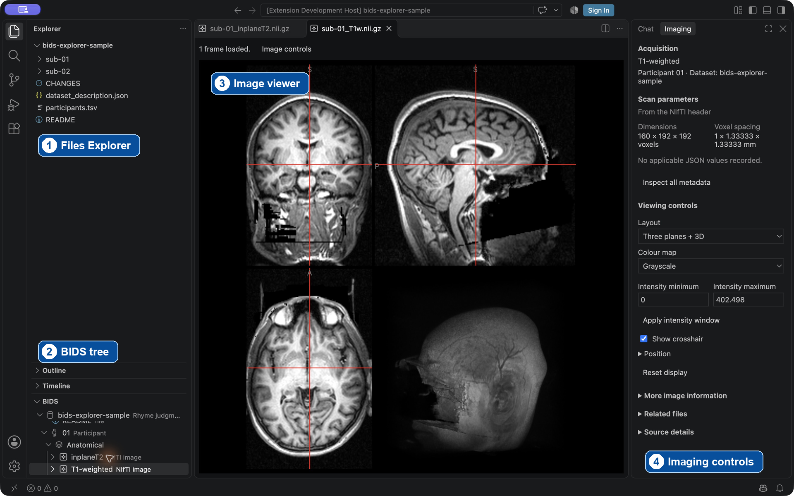

# Try BIDS Explorer in five minutes

This walkthrough uses two participants and four real anatomical MRI images, about 13 MB. It needs no programming or terminal commands. Download time depends on your connection.

If your study is already on a server, use the [Remote SSH walkthrough](REMOTE_SSH.md) instead. The steps below use a sample on your own computer.

## 1. Install the extension

Install desktop [VS Code](https://code.visualstudio.com/) 1.96 or newer. In its **Extensions** view, find **BIDS Explorer** by **Darcy Quesnel (`MCIN-dlq`)** and choose **Install**. You can also use the [Marketplace page](https://marketplace.visualstudio.com/items?itemName=MCIN-dlq.bids-explorer).

For manual installation, download `bids-explorer-1.0.4.vsix` from the [1.0.4 release](https://github.com/dlq/bids-explorer/releases/tag/v1.0.4), then choose **Extensions → … → Install from VSIX…**. If an older development copy is installed under publisher `bids-explorer-dev`, disable or uninstall it first.

## 2. Download and open the small study

1. [Download the sample ZIP](https://github.com/dlq/bids-explorer/releases/download/v1.0.1/bids-explorer-sample-ds000003.zip).
2. Extract it using Finder on macOS, **Extract All…** on Windows, or your usual archive tool on Linux.
3. In VS Code choose **File → Open Folder…** and open the extracted **bids-explorer-sample** folder. Choose the folder containing `dataset_description.json`, not its parent Downloads folder.
4. Open **Explorer** on the left and expand **BIDS**. Look for **bids-explorer-sample**, with **Rhyme judgment** as its study description. If it does not appear, choose **Add Dataset** and select the same folder.

Only mark folders as trusted when you trust their contents. This sample is a documented subset of a public study; it is separate from your research data.

For an archive collection, start with the folder containing the ZIP, tar or SquashFS files. Open that folder in VS Code and use **Add Dataset** if the collection does not appear under **BIDS**. See the [archive collection options](EXPLORER_REFERENCE.md) for supported layouts.

### Find your way around



1. **Files Explorer** shows the original files and folders, including `dataset_description.json`.
2. **BIDS** organizes the study by participant, session and modality.
3. The **image viewer** opens the selected image in the editor area.
4. **Imaging** shows scan information and display controls. Open it with **Image controls** in the viewer. The screenshot shows it moved to the right.

## 3. View an image

Expand **01 → Anatomical** and select **T1-weighted**. You should see three orthogonal planes and a 3D view. Choose **Image controls** for dimensions, voxel spacing and display controls.

To put the controls on the right, right-click **Imaging** and choose **Move To → Secondary Side Bar**. Try changing the layout or colour map, then choose **Reset display**. Expand **Position** to move the crosshair with its X, Y and Z buttons.

Participant **02** has another T1-weighted image. Full source filenames remain in tooltips and source details even though the tree uses shorter labels. Browsing does not rewrite the images.

## 4. Read the study information

Open **Dataset description**, **Participants** and `CHANGES`. Use **Filter rows** in Participants to find `sub-02`, then clear the filter. Source identifiers retain their `sub-` prefixes in the original table.

This anatomical subset has no acquisition JSON sidecars, functional scans, diffusion gradients, derivatives or session folders. Missing inherited scan parameters are expected; the subset is not evidence that the complete study lacks those data.

## 5. Check participant coverage

Right-click the dataset and choose **Show Participant Availability**. Look for the two participants and anatomical availability. The study is sessionless, so it will not show invented session 1/session 2 data. A completed check differs from **Not checked**, which means coverage is incomplete.

Use a richer study to try multi-session filters, event timing, gradient previews or preprocessing outputs. The [user guide](USER_GUIDE.md) explains these workflows and [the reference](EXPLORER_REFERENCE.md) explains explicit raw/derivative links.

## Open a scan from its table row

This walkthrough uses the scan navigation introduced in BIDS Explorer 1.1.0. Use a study with a scans table, or make the [practice folder](#make-a-practice-folder) from a copy of the public sample.

1. In **BIDS**, expand a participant and, if present, the session. Select **Scans** to open the table preview. In the practice folder, choose **01 → Scans**.
2. Find the row by its `filename` and choose **Open scan**. For the practice folder, use `anat/sub-01_T1w.nii.gz`. The path is relative to the table's folder.
3. One match opens directly. If **Choose scan source** appears, compare the locations under the filenames. In the practice folder, select the entry for `sub-01.zip` with member `sub-01/anat/sub-01_T1w.nii.gz`. Press **Enter** to open it.
4. Check the viewer tab for `sub-01_T1w.nii.gz` and the status for **1 frame loaded**. If the table reports that a source was unchecked or unreadable, inspect the relevant branch or refresh it and try the row again.

### Make a practice folder

1. Make a separate copy of **bids-explorer-sample** and name the copy **scan-example**.
2. In the copy, create the plain-text file `sub-01/sub-01_scans.tsv` with these two lines:

   ```text
   filename
   anat/sub-01_T1w.nii.gz
   ```

3. To try the direct-open case, open **scan-example** in VS Code and follow the walkthrough before adding an archive.
4. To try the picker, compress a copy of the original sample’s **sub-01** folder with Finder or your file manager. Put the resulting **sub-01.zip** at the root of **scan-example**, alongside the loose **sub-01** folder. The archive should contain `sub-01/anat/sub-01_T1w.nii.gz`. Use **Refresh** in the BIDS heading, then open the same row again.

## A few BIDS terms

- **Participant** is the person or other subject studied, recorded with an identifier such as `sub-01`.
- **Session** groups acquisitions from a visit or other recording period, with an identifier such as `ses-01` when the study uses sessions.
- **Acquisition** is a recorded scan or recording, such as a T1-weighted scan or a BOLD run.
- **Derivative** is a result produced by processing source data, such as a preprocessed image or segmentation.
- **Inherited metadata** comes from a JSON file at a broader level that applies to the selected scan. More specific applicable JSON can override its values.

BIDS Explorer browsing and previews are read-only. Archive indexes and extracted images can be stored in extension caches outside the study. **Open original** can open a loose file in an editor where saving can change it. See the [Remote SSH storage notes](REMOTE_SSH.md#what-stays-on-the-server) when using server data.

If the sidebar is hidden, choose **View → Explorer** and expand **BIDS**. Choose **Reset display** in Imaging to restore the default view. Use **Refresh** in the BIDS heading after adding files or an archive. See [Troubleshooting](TROUBLESHOOTING.md) for more recovery steps.

## What is in the sample?

The sample is an anatomical subset of [OpenNeuro ds000003, Rhyme judgment](https://openneuro.org/datasets/ds000003), credited upstream to G. Xue and R. A. Poldrack. It retains the upstream README, dataset description and CHANGES. The original distribution requests acknowledgement of OpenfMRI and NSF Grant OCI-1131441 (R. Poldrack, PI); retain and consult those upstream notices.

Only participants `sub-01` and `sub-02` and their anatomical images are included. The sample participant table was filtered to those two participants during its original preparation. No new dataset edits are performed by this walkthrough. The ZIP includes source URLs, hashes and a scope/attribution note. This sample is not a complete dataset or a validation result, and the data retain their upstream licensing rather than the extension's MIT license.

If something does not work, use [Troubleshooting](TROUBLESHOOTING.md). Report the failing step and extension/VS Code versions, without private study information.
