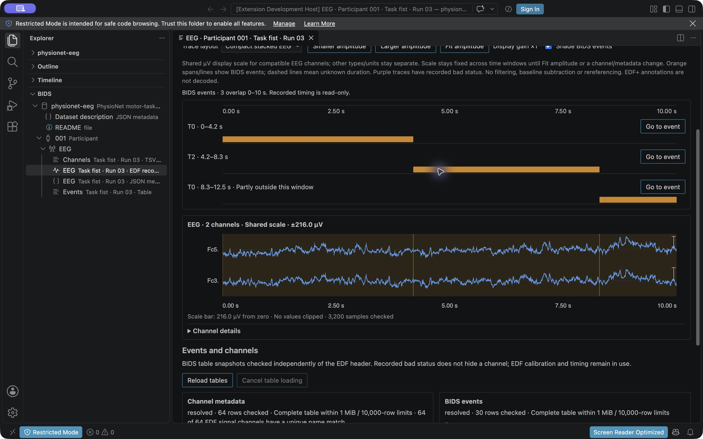
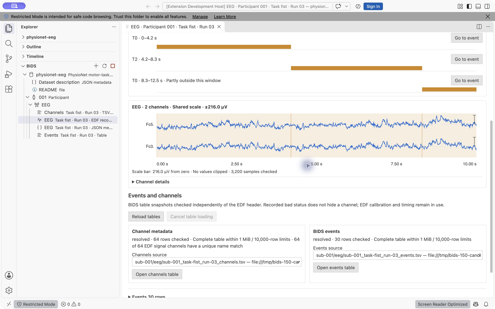
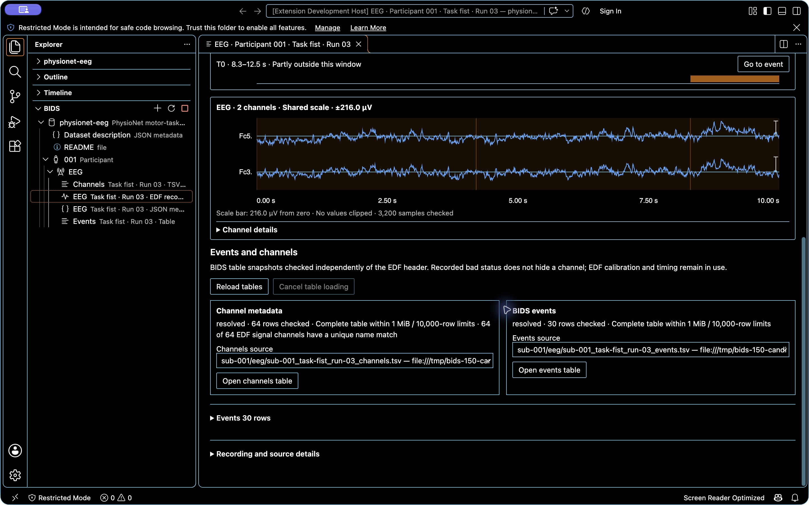

# 1.5.0 candidate: EEG usability and package checks

Recorded November 26, 2026. This records the candidate checks completed before 1.5.0 release preparation. Local and Remote SSH package checks passed. The user subsequently approved the realistic EEG presentation and confirmed clear VoiceOver announcements on November 26, 2026. The candidate below is distinct from the final release package.

## Candidate and scope

The candidate comes from `8451fa9` plus the EEG canvas theme-redraw fix and its regression test, which were uncommitted at candidate-test time. At candidate-test time, an isolated snapshot updated its manifest/lockfile version to 1.5.0 while the main checkout remained 1.4.0. The VSIX is 2,276,278 bytes, SHA-256 `2f0d24c4876a872e2bd4303eaf49272830610b44f1a67038d615a0b342190303`. Release preparation follows these checks and verifies runtime equivalence with the eventual release artifact.

The selected scope remains ordinary EDF and continuous EDF+ with known duration. EDF+D/unknown-duration recordings retain technical summaries. Other EEG/MEG formats, annotation decoding, filtering, rereferencing and efficient late-window archive reads are outside this milestone.

## Physiological EEG example

The public [PhysioNet EEG Motor Movement/Imagery Dataset 1.0.0](https://physionet.org/content/eegmmidb/1.0.0/), recording S001R03, supplies 125 seconds of physiological EEG: 64 numeric channels at 160 Hz and an EDF+ annotation channel. Attribution: Schalk, G. (2009), DOI [10.13026/C28G6P](https://doi.org/10.13026/C28G6P); Open Data Commons Attribution License 1.0. The upstream documentation also requests citation of Schalk et al., _BCI2000: A General-Purpose Brain-Computer Interface (BCI) System_, IEEE TBME 51(6):1034–1043 (2004).

Downloaded EDF: 2,596,896 bytes, SHA-256 `3427c8d01bff1380bc9ab9f27a35ece2af5dfadf3e291bbc05eb66e4dadbfe2e`. Original and test copies stay outside Git. No clinical interpretation is claimed.

A separate BIDS-shaped fixture wraps the unchanged EDF bytes. Its generated channels table copies exact header labels/units/rates and assigns EEG type from the source documentation. A standalone Python fixture-preparation script extracts 30 annotation intervals into an events table, retaining literal T0/T1/T2 codes. It invents no channel quality or reference. These tables are test adaptations, not upstream BIDS metadata or a validated BIDS conversion. The extension still does **not** decode EDF+ annotations. Python independently calibrates the first ten seconds from little-endian samples; installed-package assertions compare the first channel's minimum/maximum with that reference.

## Usability walkthrough

The native VS Code walkthrough used the latest development build on macOS/VS Code 1.148.0. The installed-package checks below are separate evidence. Screenshots are actual saved native-app captures of the public recording; they inherit the source attribution above.

1. **Find and open the recording — clear.** Participant 001 → EEG → EEG, Task fist, Run 03 opens waveforms directly. Header context states 64 signal channels, EDF+C, 125 seconds and the source of rates/units. Only two channels/ten seconds load initially; partial recording coverage is explicit.
2. **Select and scale channels — functional.** Four physiological channels were selected, including a channel checkbox operated with Tab/Space. Larger amplitude worked with Shift+Tab/Return; the gain, physical range and clipping notice changed. Fit restored the scale. Installed-package tests additionally select eight channels and switch between stacked and individual layouts. The trace layout preserves exact recorded labels and shows a physical scale bar.
3. **Follow an event — functional.** Named/timed T0/T2 intervals align horizontally with trace time ticks and shading. Go to event moved the window to 4.2 seconds while retaining the physical range. Shading toggled by mouse and Space. Original event codes remain literal; their task meaning is not inferred. This is read-only navigation.
4. **Change theme — fixed and rechecked.** The initial high-contrast → light switch left old canvas text colours behind. The fix repaints on body theme class/style changes, preserving data and display settings. Saved light/high-contrast/dark views show readable labels, ticks and scale bars after switching. A real-webview regression checks changed foreground pixels and unchanged selected window/gain/ranges; installed-package probes also check recolouring.

The named controls, logical reading order, live loading/gain status and canvas descriptions were present in the accessibility tree. This is sampled keyboard and visual evidence, not full WCAG conformance or an EEG practitioner's endorsement. The user then completed the realistic EEG review and stated: “looks good and VoiceOver announces everything clearly.” That confirms the reviewed controls and status announcements, without establishing conformance on other assistive technologies/platforms. The earlier synthetic-demo user approval is separate evidence.

The event timeline and source context consume vertical space, so traces require scrolling on shorter viewports. This did not block the walkthrough; keep compact presentation as a follow-up when reviewing dense event windows. No new layout redesign is included in this candidate.

## Local package and automated checks

- Locked dependency installation completed. Formatting, TypeScript, ESLint and all 222 unit tests/per-file coverage gates passed. Semgrep rules/source scan passed with zero findings; the dependency audit reported zero vulnerabilities.
- Full integration suites passed **66 tests each** on minimum VS Code **1.96.0** and current **1.148.0**. Two deliberately opt-in tests remain pending. The theme regression is included.
- The same built VSIX was installed into isolated extension directories, without replacing the user's Marketplace installation. A temporary test extension activates that installed extension, follows its logical sources and invokes its registered Open File command. It injects unshipped webview controls/inspection for assertions; no source-checkout production modules are imported by the package harness.
- **Ten installed-artifact cases passed on each version**: physiological EDF+C and synthetic ordinary EDF, each loose, ZIP, tar, gzip tar and gzip SquashFS. Cases check calibrated source units/ranges, actual trace/shading pixels, shared stacking, gain/fit, fixed scale across time navigation, event jumps, layout changes, late windows within the small-file budget, and live theme recolouring. All 19 fixture/container files retained their hashes on each run.
- Test windows closed automatically. The local physiological example was reopened in the existing demo window for the completed user review. The production extension still requires trusted workspaces; disposable package tests disable the trust prompt only for these generated/public test inputs. Development-host Restricted Mode behavior does not establish installed extension support in Restricted Mode.

The existing NIfTI PNG-capture assertion intermittently timed out when a test renderer was not active. Successful full reruns retained all assertions. The temporary test harness disables background renderer/timer throttling, and the current-version test window was explicitly brought forward. No MRI production code or screenshot assertion was weakened. This is a test-environment limitation to retain in release evidence.

[Numeric installed-package results](results.json) contain rendered-action markers, not human-visible first-pixel or SSH-wire measurements. These small examples do not establish performance on long physiological recordings.

## Remote SSH package checks

After the user completed MFA, the existing Rorqual window was reused on VS Code 1.148.0 / Remote SSH 0.128.0, Linux, workspace-host Node v24.22.1. No additional test window was needed. The candidate VSIX was uploaded to isolated remote temporary storage; its SHA-256 matched the local candidate exactly. The VS Code server CLI installed it into a temporary extension directory. All 423 installed payload files matched the VSIX, allowing only normal installer-added manifest metadata. The candidate and an unshipped test harness were temporarily registered with the existing server. The harness asserted extension version 1.5.0 and used its actual registered Open File command and packaged clients.

**All 14 Remote SSH cases passed:**

| Workload                                                 | Sources                                  | Cases | Result                                                                                                                                                       |
| -------------------------------------------------------- | ---------------------------------------- | ----: | ------------------------------------------------------------------------------------------------------------------------------------------------------------ |
| Physiological EDF+C, 64 channels/125 s                   | Loose, ZIP, tar, gzip tar, gzip SquashFS |     5 | Calibrated range, eight-channel stack, individual layout, gain/fit, fixed range, shading, event jump, late small-file window and theme repaint passed        |
| Synthetic ordinary EDF, 4 channels/20 s                  | Same five sources                        |     5 | Default opening, calibrated units, shared stack, amplitude controls, shading, navigation and theme repaint passed                                            |
| Large synthetic EDF and EDF+C, 64 numeric channels/600 s | Loose and ZIP for each                   |     4 | Separate EEG/ECG groups; 590-second loose windows loaded; ZIP windows exceeding 16 MiB were explicitly refused while retaining the completed 5-second window |

All **31 tested physical fixture/container files retained their hashes**. The large synthetic fixtures were generated afresh in remote temporary storage because the earlier audit's temporary fixtures were no longer present. No research recordings were used by these tests. First rendered-action markers ranged from approximately 0.20 to 0.70 seconds across these single opens. These include instrumented checks and uncontrolled filesystem/session caches; they are not human-visible first-pixel, cold-start, bulk-transfer or SSH wire-byte measurements.

After all preview panels closed, a supplementary marker scan checked **358 ordinary client-profile files**, totalling 50,682,467 bytes, with **zero marker hits and zero skipped files**. It searched the large synthetic fixtures' known raw sample, decoded-trace JSON, identifier and metadata markers in literal, UTF-16 and base64 forms, including bounded embedded gzip decoding. Four fresh positive-control files produced 75 marker hits, including gzip. This is one post-preview snapshot, not a repeat of the earlier full close/reload/reconnect audit or a guarantee about arbitrary encodings, browser memory, OS swap, crash reports, clipboard, exports or other extensions. The earlier [30-case synthetic audit](../edf-remote/REPORT.md) records the broader lifecycle method and its limits.

Cleanup restored the prior remote BIDS Explorer 1.3.0 registration and removed only the two temporary candidate/harness registrations and their checked symlinks. The original installed extension directory was preserved. Test inputs, candidate and raw evidence remain outside Git in temporary storage. The existing connected window was returned to its UKB published SquashFS example and its collection setting restored. Restoration is separate from the EEG measurements.

## Release closeout

The minimum/current and exact-candidate Remote SSH package checks are complete. The user approved the realistic EEG/VoiceOver walkthrough and authorized 1.5.0 publication after documentation and final checks on November 26, 2026. The candidate measurements above retain their original scope. Final release packaging and hosted validation are recorded in the compatibility document and GitHub release.
